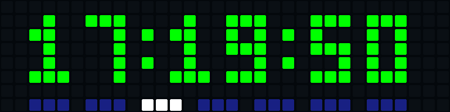

# Pixel-MB · ESP8266

Firmware Arduino para convertir un **D1 mini / ESP8266** y una matriz WS2812B de **32×8** en una pantalla autónoma. Incluye editor web, API HTTP, animaciones locales, sensor BMP280 y actualizaciones OTA. No necesita un servidor externo.



Vista de la matriz 32×8: reloj con segundos y siete indicadores de lunes a domingo; el día actual se destaca en blanco.


## Funciones

- Portal WiFi para configurar la red y escanear redes de 2,4 GHz.
- Hotspot de recuperación tras 15 segundos sin conexión y reintentos cada 30 segundos.
- Editor de animaciones en el ESP: importar/exportar JSON y guardar hasta 48 animaciones.
- Rotación ordenable de hasta 16 pantallas con duración y color independientes.
- Reloj, temperatura, presión, texto, animación concreta y animación aleatoria.
- Opciones de segundos y días de la semana en cada fila Hora.
- Iconos de hasta 8×8 acompañados de texto y variables; texto completo sin icono.
- Notificaciones temporales y variables actualizadas por API.
- Escena base con botón para fijar/desfijar y recuperar la rotación.
- Logo Pixel-MB al arrancar e IP desplazable durante 4 segundos al conectar.
- Actualización de firmware por USB u OTA autenticada.

## Hardware predeterminado

| Componente | Conexión |
| --- | --- |
| Placa | Wemos/LOLIN D1 mini, ESP8266, flash de 4 MB |
| Matriz | WS2812B 32×8, orden GRB, columnas en zigzag |
| DIN de la matriz | D2 / GPIO4 |
| BMP280 SDA | D3 / GPIO0 |
| BMP280 SCL | D1 / GPIO5 |
| GND | Común entre placa, matriz y alimentación |

Configura otro cableado o disposición en [`include/Config.h`](include/Config.h). Alimenta la matriz con una fuente de 5 V adecuada para el número de LED y brillo utilizados. El BMP280 debe usar niveles compatibles con 3,3 V. D3/GPIO0 es un pin de arranque del ESP8266: el sensor no debe mantenerlo a nivel bajo al encender.

El BMP280 mide temperatura y presión; no humedad ni CO₂. Estos últimos valores se reciben por API desde sensores externos.

## Compilar y primera carga

Instala PlatformIO y abre esta carpeta como proyecto. Desde el terminal:

```sh
pio run -e d1_mini
pio run -e d1_mini -t upload
pio device monitor -b 115200
```

El proyecto usa Arduino como framework. PlatformIO instala las versiones de las dependencias definidas en [`platformio.ini`](platformio.ini). El editor y las animaciones predeterminadas se generan e incorporan al compilar; **no hace falta cargar LittleFS** para la instalación normal.

La primera compilación crea `ota.local.json` y `include/LocalOtaConfig.h` con credenciales OTA propias. Ambos están excluidos de Git. No publiques esos archivos ni binarios personales que las incorporen.

## Configurar WiFi

1. Conecta la placa por USB para la primera carga.
2. Sin red configurada, busca el hotspot **`PIXEL-MB-xxxxxx`**.
3. Conéctate con la clave **`pixel-mb-local`**.
4. Abre **http://192.168.4.1/**, escanea las redes y guarda tu SSID y contraseña.
5. Al conectar al router, la matriz muestra su IP durante 4 segundos. Abre **http://IP_DEL_ESP/**, sin añadir puerto.

Si la red falla, el hotspot aparece tras 15 segundos y se intenta recuperar la conexión cada 30 segundos. El portal permanece disponible mientras reintenta. El reloj sincroniza la hora mediante NTP y está configurado para España peninsular; cambia `TIMEZONE` en `Config.h` si procede.

## Rotación y animaciones

En «Rotación de pantallas», añade las páginas, ordena con Subir/Bajar y configura sus segundos. En cada fila Hora puedes activar **Segundos** y **Días de la semana**. Las siete marcas van de lunes a domingo; el día actual es blanco y los demás azules.

Para mostrar valores externos, añade una fila Texto con `CO2: {Co2}` o un icono con texto. Los textos largos se desplazan. Aplica y guarda la rotación para conservar los cambios.

Importa un JSON desde el editor y pulsa «Guardar en ESP8266». La placa guarda solo lo que elijas. Cada animación puede marcarse para la lista aleatoria; añade una fila «Animación aleatoria» para utilizarla. Las descargas desde el editor son JSON.

La [galería de animaciones](https://diegomardev.com/apps/pixel-mb) sirve para previsualizar y descargar; después se importan los archivos en el ESP. Este repositorio no redistribuye ese catálogo ni logos personales. Los ejemplos propios y cuatro efectos con licencia y atribuciones están en [`examples`](examples) y [`data/animations`](data/animations); consulta [`ANIMACIONES.md`](ANIMACIONES.md).

Para cargar tus propios JSON de `animations_default` por API:

```sh
python3 tools/install_default_animations.py --host http://IP_DEL_ESP --upload
```

## API rápida

```sh
# Cambiar brillo; 0 apaga los LED sin desconectar el ESP.
curl -X POST http://IP_DEL_ESP/api/v3/settings \
  -H 'Content-Type: application/json' -d '{"Brightness":30}'

# Actualizar variables.
curl -X POST http://IP_DEL_ESP/api/variables \
  -H 'Content-Type: application/json' -d '{"Temp":23.4,"Hum":48,"Co2":650,"TVOC":32}'

# Mostrar un aviso temporal.
curl -X POST http://IP_DEL_ESP/api/v3/notify \
  -H 'Content-Type: application/json' \
  -d '{"data":"CO2: {Co2}","duration":5,"color":[0,255,0],"force":true}'
```

Manual completo: **[`API.md`](API.md)**. La API admite una cabecera opcional `X-API-Key`, configurada al compilar en `Config.h`; por defecto está vacía.

## OTA

Tras la primera carga USB, cambia el campo `host` de tu archivo privado `ota.local.json` por la IP de la placa y ejecuta:

```sh
pio run -e d1_mini_ota -t upload
```

No cambies la contraseña generada entre compilaciones si quieres seguir actualizando el mismo dispositivo. La OTA de firmware conserva las animaciones y la configuración. La carga OTA del sistema de archivos está desactivada para evitar sustituir esos datos. Más detalles en [`OTA.md`](OTA.md).

## Pruebas para desarrolladores

Estas pruebas son opcionales y requieren Python 3 y Node.js.

```sh
python3 -m unittest discover -s tests -p 'test_*.py'
node tests/test_editor.js
node tests/test_clock_options_editor.js
node tests/test_rotation_duration.js
node tests/test_base_scene.js
python3 tests/test_compact.py
node tests/test_compact_editor.js
```

Las pruebas nativas C++ del reloj, rotación, reconexión, renderizado e indicadores se encuentran en `tests`. Por ejemplo:

```sh
g++ -std=c++17 -Iinclude tests/test_weekday.cpp -o /tmp/pixel-weekday
/tmp/pixel-weekday
```
